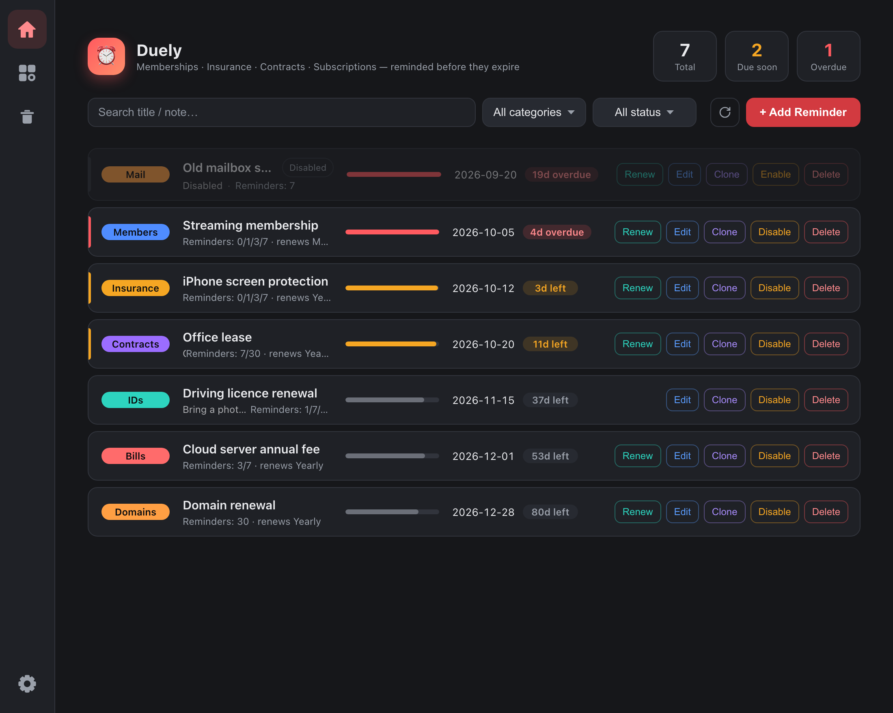
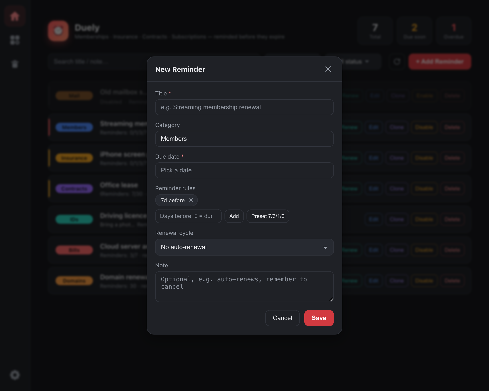
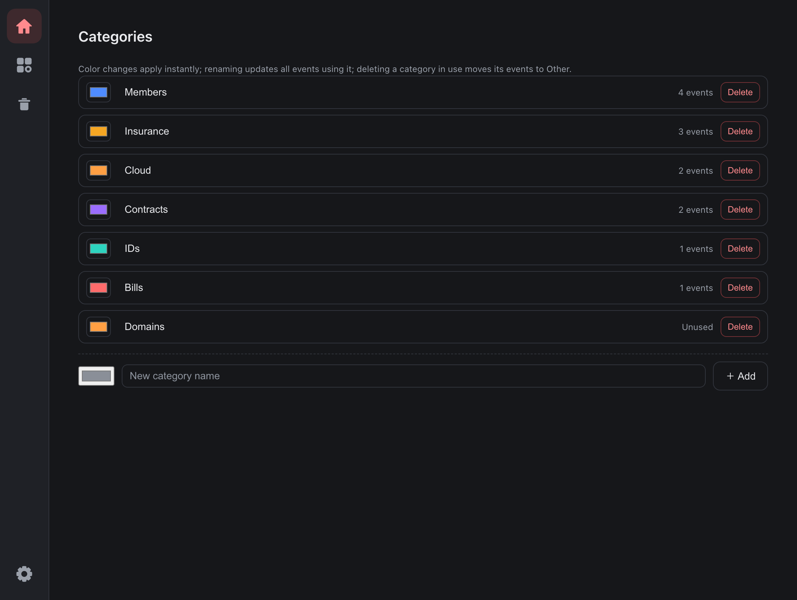
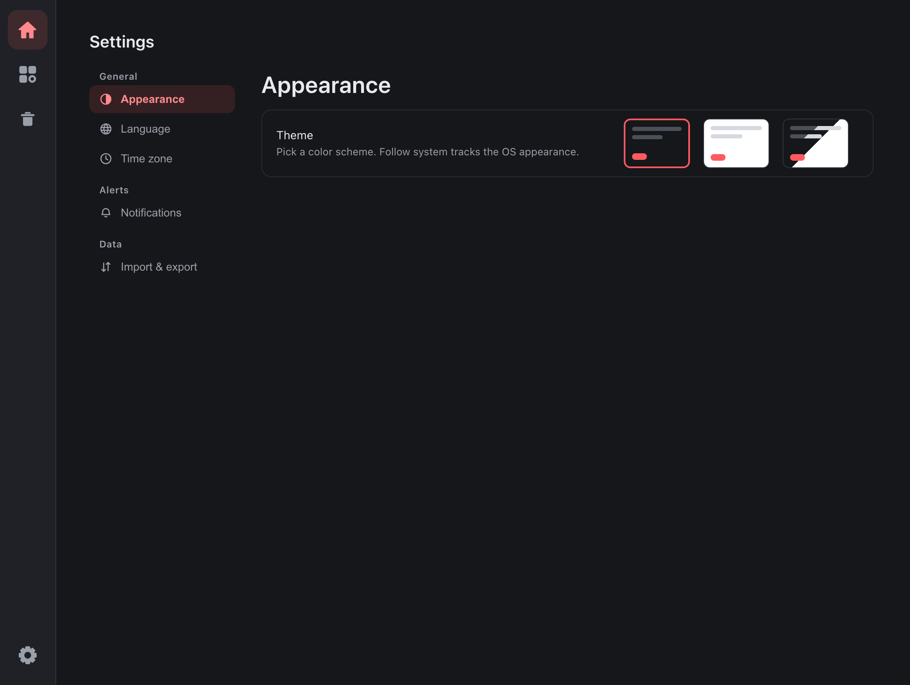
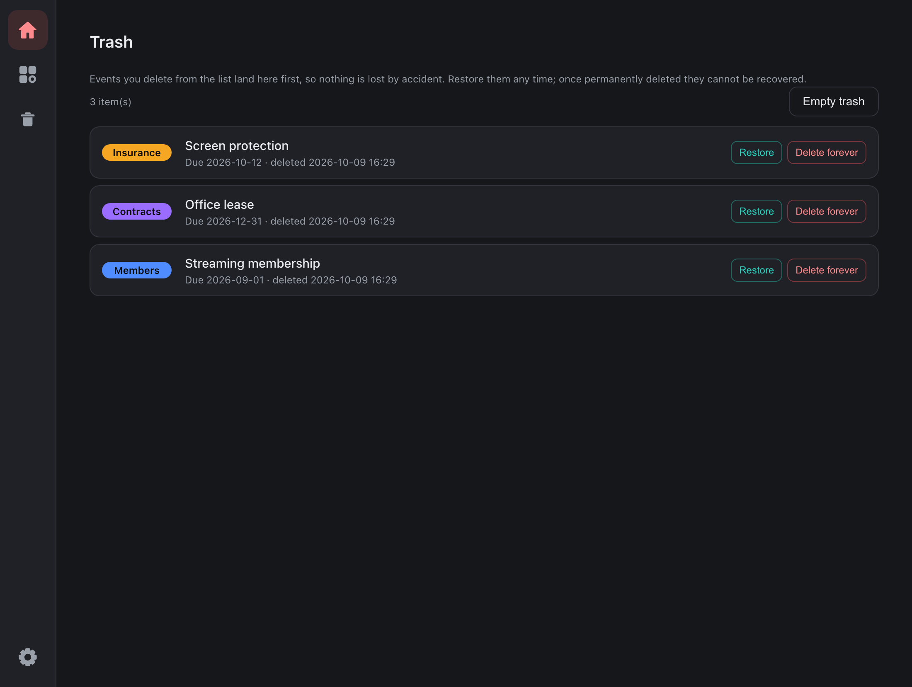
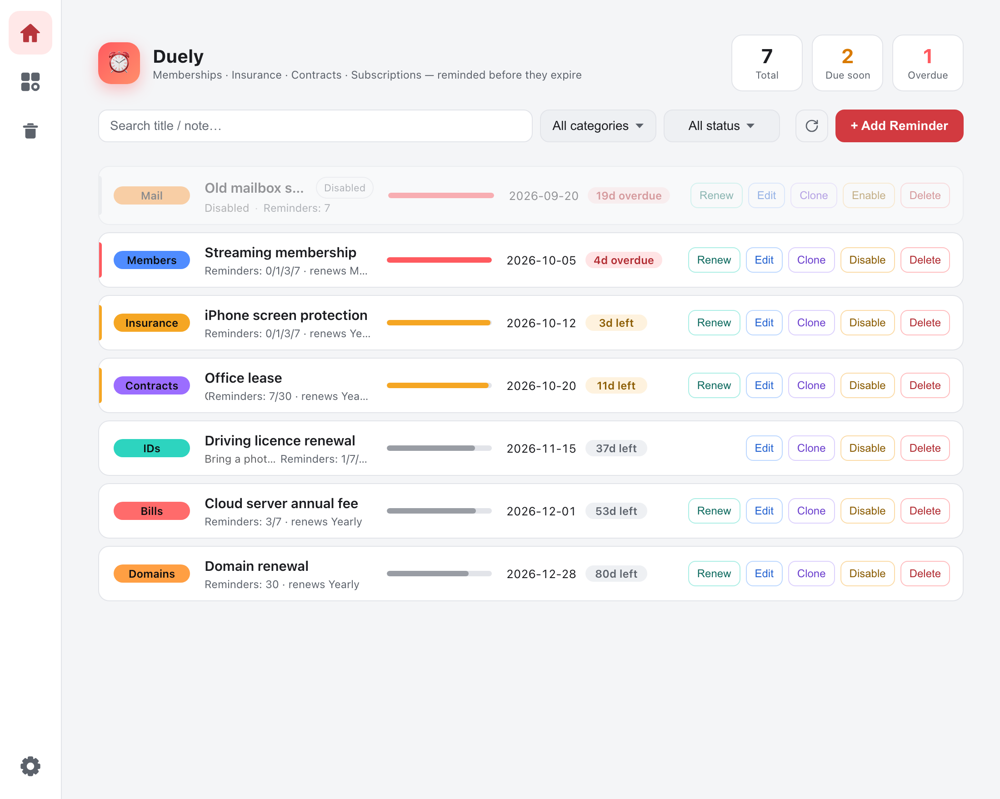

# Duely (如期而至)

<p align="center">
  
</p>

<p align="center">
  <a href="https://github.com/chaun1008/duely"></a>
  
  
  
</p>

<p align="center"><a href="README.md">简体中文</a> ｜ <b>English</b></p>

**Duely** is a cross-platform desktop app that keeps an eye on everything with an expiry date — **memberships, insurance, contracts, IDs, bills, subscriptions** — and pops a **system notification** before it's due. Closing the window doesn't matter: as long as it's still sitting in the tray, reminders won't be late.

> The Chinese name 如期而至 (*rú qī ér zhì*) means "arrives right on schedule", a nod to 如约而至: what needs reminding gets reminded on time.
> The English name **Duely** plays on *due* and *duly* — on time, and done properly.

---

## ✨ Features

**Managing reminders**

- ➕ **Custom reminders**: title, category, due date, note — track whatever you need
- 📅 **Built-in due-date calendar**: click "Pick a date" to open a month grid — adjacent months greyed out but clickable, today outlined, the selection highlighted, a fixed 42 cells so the panel never jumps between months; click the title for a month picker and "Today" at the bottom jumps back. No native date control, so dark and light look the same
- 🏷️ **Preset + custom categories**: Memberships / Insurance / Contracts / IDs / Bills / Subscriptions / Other, or type your own; each can be recolored, renamed or deleted (renaming syncs the reminders that use it, deleting one in use moves them to "Other")
- ⏰ **Multiple reminder rules**: give a reminder several rules (e.g. 7 / 3 / 1 / due day) and it fires when the days-left count lands **exactly** on one of them; one-click "Preset 7/3/1/0"
- 🔁 **Renewal cycle + one-click renew**: monthly / quarterly / semi-annually / yearly; Renew continues from the current due date and rolls past expired periods forward to the next future one
- 📋 **Clone & disable**: clone a frequent reminder in one click (auto " (copy)" suffix); pause a subscription with Disable — no more reminders, data kept
- 🗑️ **Trash**: deleting moves items here (soft delete) and they can be restored any time; trashed items never remind and don't count in the stats. "Delete forever" asks for confirmation and cannot be undone

**Finding things**

- 🔍 **Filter & search**: filter by category, search titles/notes; each dropdown entry is tagged with how many reminders it would show and the list is sorted by that count
- 📊 **Stat cards are filters**: the three cards on top — Total / Due soon / Overdue — filter the list when clicked, click again to clear
- 📅 **Status rules**: disabled > overdue > due soon (0 ≤ days left ≤ largest reminder lead) > OK; the list is sorted by due date ascending
- 🧭 **A list you can scan**: category chip, title + summary, date + days left and actions each sit in a fixed column and line up across rows; a **cycle progress bar** in the middle shows how far the current period has run — it follows the renewal cycle when there is one (and resets on Renew), otherwise it counts from the day you added the reminder. Grey normally, amber when due soon, full red when overdue
- 🔄 **One-click refresh**: reloads the local data and recomputes days-left against today's date — handy after editing the data files by hand, or when the app has been running across midnight

**Reminders**

- 🔔 **System notifications**: a background thread scans every 60 seconds; items not yet due fire when the days-left count matches a rule exactly, overdue ones nag once a day for up to 30 days; trashed items never fire
- 📌 **Closing the window doesn't quit**: it just hides to the tray, where "Show window / Quit" live
- 🤖 **Group-bot push**: due reminders are also pushed to any configured WeCom / DingTalk bot (5-second timeout; failures are logged and never affect local reminders). "Send test" lives in Settings

**Interface & data**

- 🎨 **Dark / light / follow system**: three-way theme applied before the first frame, so there's no white flash
- 🌐 **Chinese & English** plus **time zone**: switches apply instantly (the brand name follows too: 如期而至 / **Duely**); the time zone affects dates and days-left in the UI while notifications still follow system time
- 📌 **Sticky header**: search / filters / "+ Add Reminder" stay pinned to the top however long the list gets, with a divider showing once they stick
- 💾 **Local data + backup**: everything is local JSON; export/import in one click and carry it to another machine
- 🪟 **Responsive window**: narrow windows tighten the padding and fold each card into two columns (date and actions on their own rows); wide windows add breathing room and the progress bar fills the row so big screens don't feel empty

---

## 📸 Screenshots

**Main window**: the icon rail switches pages; category chip / title + summary / date / actions line up in four columns and reminders are sorted by due date. Between the title and the date sits the **cycle progress bar** — how far this period has run at a glance, with due today / due soon / overdue all obvious.



**New Reminder**: title, category, due date, multiple reminder rules, renewal cycle and note, all in one dialog.



**Categories**: recoloring applies instantly; renaming syncs the reminders that use it; deleting a category in use moves its reminders to "Other".



**Settings**: general / alerts / data on the left, each option on the right, saved as you change it.



**Trash**: "Delete" in the list only moves items here and they can be restored; "Delete forever" needs confirmation and cannot be undone.



**Light theme**: one set of design tokens shared with the dark theme, so a single switch flips everything.



---

## 📥 Download & install

### Prebuilt packages (recommended)

| Platform | File | Notes |
| --- | --- | --- |
| macOS (Apple Silicon) | `如期而至.app.zip` | Unzip, then double-click the `.app` |
| Windows | `如期而至_x.y.z_x64_en-US.msi` / `*.exe` | Double-click to install |

> Unsigned builds are blocked on first launch: on macOS right-click → Open and confirm; on Windows click "More info → Run anyway".

### Build from source

```bash
git clone https://github.com/chaun1008/duely.git
cd duely
npm install      # installs @tauri-apps/cli and vite
npm run build    # produces the platform installers
```

Artifacts land in:

- macOS: `src-tauri/target/release/bundle/macos/如期而至.app` and `…/dmg/如期而至.dmg`
- Windows: `src-tauri/target/release/bundle/msi/如期而至_x.y.z_x64_en-US.msi` and `nsis/*.exe`

#### Prerequisites

- **macOS**: [Rust](https://www.rust-lang.org/) + Xcode command line tools (`xcode-select --install`) + Node.js 20.19+ / 22.12+ (Vite 8 requires it)
- **Windows**: [Rust](https://www.rust-lang.org/) (MSVC toolchain) + [Node.js](https://nodejs.org/) 20.19+ / 22.12+ + the [WebView2](https://developer.microsoft.com/microsoft-edge/webview2/) runtime
- **Linux** (extra support): `webkit2gtk-4.1` / `librsvg` / `patchelf` and other system libraries

---

## 🚀 Usage

1. Open the app and click "+ Add Reminder"; fill in a title, category and due date, adding reminder rules as needed
2. The list is sorted by due date; items due soon or overdue are highlighted and raise a system notification
3. Closing the window leaves the app running in the tray, so reminders still arrive on time
4. To push into a group chat: Settings → Notifications, paste your WeCom / DingTalk bot webhook and hit "Send test"
5. Moving to another machine: Settings → Import & export, export the JSON, import it on the other machine

---

## 🗂️ Where the data lives

Runtime data lives in the platform's standard app config directory, as three files:

| File | Contents |
| --- | --- |
| `events.json` | Every reminder (rules, renewal cycle, disabled state, last notification time, delete marker) |
| `categories.json` | Custom categories and their colors |
| `settings.json` | Language, time zone and the two bot webhook URLs |

Paths:

- macOS: `~/Library/Application Support/com.ruqierzhi/`
- Windows: `C:\Users\<you>\AppData\Roaming\com.ruqierzhi\`

> Webhook URLs contain a secret (`key` / `access_token`). They only ever live in this local `settings.json` and are never uploaded anywhere.

Backup / migration: "Export" writes a JSON file (**events only — no categories or settings**); "Import" on another machine restores it (importing replaces all current events, and trashed items are included in the backup).

---

## 🔧 How reminders work

- A background thread starts with the app and checks every reminder every 60 seconds
- **Not yet due**: fires once when the days-left count equals one of the reminder's rules (0 = due day)
- **Overdue**: nags once a day for up to 30 days; anything older stops notifying but stays visible in the list
- **Disabled** reminders never fire
- **Trashed** items never fire either (deleted things shouldn't nag you); restore one and it reminds you again
- No duplicate popups in a day: `notified_at` dedupes by date (at most one per reminder per day)
- On a hit: ① a system notification; ② one message per configured group bot
- Closing the window only hides it to the tray — the process keeps running, so reminders still arrive on time
- To stop reminders entirely: "Quit" from the tray menu

---

## 🧱 Tech stack

- **Frontend**: plain HTML / CSS / JavaScript (no framework), calling the backend through Tauri's global `window.__TAURI__.core.invoke`; hand-rolled dropdowns and calendar instead of native controls
- **Dev server**: Vite (`npm run dev:vite`, port 3000, full page reload when `src/` changes)
- **Backend**: Rust + Tauri 2 + `tauri-plugin-notification` (system notifications) + `tauri-plugin-dialog` (file pickers for import/export)
- **Networking**: `ureq` (blocking HTTP for the group-bot webhooks)
- **Packaging**: `@tauri-apps/cli` (`tauri build`)
- **Icons**: `src-tauri/gen_icon.py` (numpy + Pillow) renders the source image and `tauri icon` (`npm run icon`) emits the full set.
  The palette is **read straight from the theme variables in `src/style.css`** (`--accent` / `--accent-btn` / `--ok` plus the `.logo` gradient end), so changing the theme color needs no script edits; the `CONCEPT` / `CHECK` / `HEADER` switches at the top of the script pick the icon concept, the check color and whether the calendar header band is drawn

### Backend commands

| Command | Purpose |
| --- | --- |
| `get_events` / `save_events` | Read / overwrite all reminders (sorted by due date on save) |
| `import_events` / `export_events` | Pick a file to import / export JSON |
| `renew_event` | Roll the due date forward to the next future period |
| `get_categories` / `save_categories` | Read / save the category list |
| `get_settings` / `save_settings` | Read / save language, time zone and webhooks |
| `test_webhooks` / `test_notify` | Send a test group message / a test system notification |

> Deletion is a **soft delete**: every reminder in `events.json` carries an optional `deleted_at` timestamp, and a value means it's in the trash. That makes restoring trivial and gives "which items count for reminders and stats" a single source of truth (`due_hit()`), instead of pulling entries out of the array.

---

## 📂 Project layout

```
duely/
├── package.json            # frontend scripts (dev / build / icon)
├── vite.config.js          # Vite dev server (root=src, port 3000)
├── src/                    # frontend (plain HTML/CSS/JS, no framework)
│   ├── index.html
│   ├── style.css
│   └── app.js              # all UI logic (including the i18n dictionary)
├── src-tauri/              # Rust backend + Tauri config
│   ├── Cargo.toml
│   ├── tauri.conf.json
│   ├── build.rs
│   ├── capabilities/default.json
│   ├── src/main.rs         # data model / persistence / scheduler / tray / notifications / webhooks
│   ├── icons/              # app icons (generated by tauri icon)
│   ├── icon-source.png     # icon source image
│   └── gen_icon.py         # icon generator (palette read from src/style.css)
├── docs/screenshots/       # README screenshots (`*.png` Chinese UI / `en-*.png` English UI)
├── LICENSE
├── .gitignore
├── README.md               # Chinese README
└── README.en.md            # English README (this file)
```

---

## 🗺️ Roadmap

- [ ] Launch at login
- [ ] Lunar calendar / working-day reminders
- [ ] More group bots (Feishu / Slack / generic webhook templates)
- [ ] Event groups and tags
- [ ] Multi-device sync (optional self-hosted backend)

Issues and pull requests are welcome.

---

## 🤝 Contributing

1. Fork the repo and `git clone` it locally
2. Create a branch: `git checkout -b feat/your-feature`
3. Commit your changes: `git commit -m "feat: ..."`
4. Push and open a pull request

Use `npm run dev` for Tauri dev mode (it starts Vite first; frontend edits reload the page, Rust edits recompile and restart).

When you touch the README, update **both languages** (`README.md` / `README.en.md`) — they are two versions of one document, so don't leave one behind.

Before pushing, make sure `cargo check`, `cargo test` and `npm run build` pass.

---

## 📄 License

[MIT](LICENSE) © Duely Contributors
