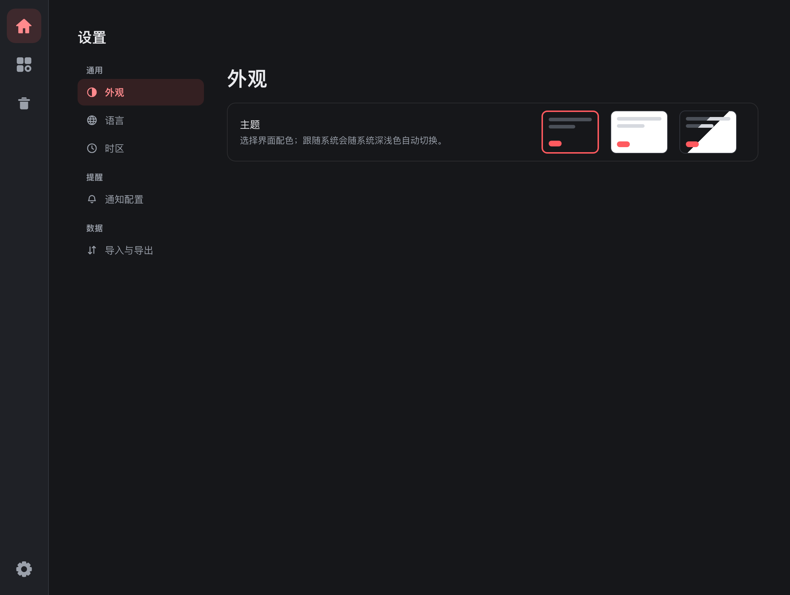
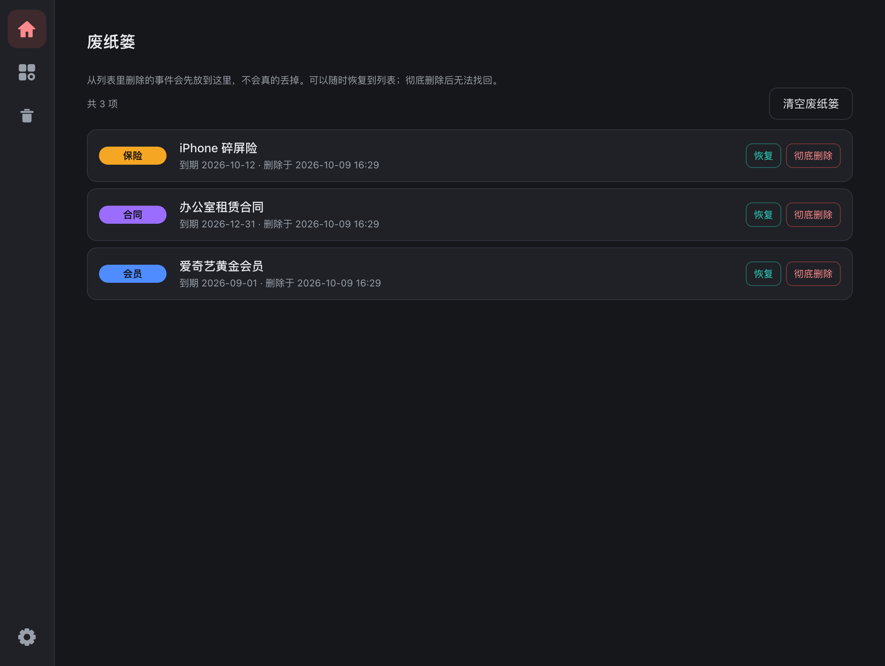
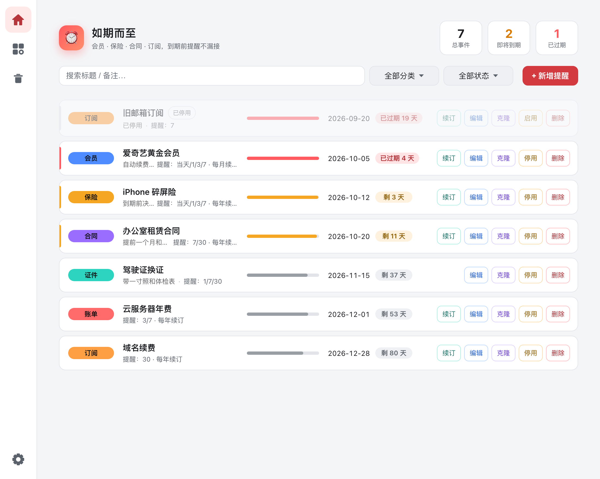

# 如期而至

<p align="center">
  
</p>

<p align="center">
  <a href="https://github.com/chaun1008/duely"></a>
  
  
  
</p>

<p align="center"><b>简体中文</b> ｜ <a href="README.en.md">English</a></p>

**如期而至** 是一款跨平台桌面应用，帮您盯住 **会员、保险、合同、证件、账单、订阅** 等一切会到期的事，到期前按时弹出**系统级通知**。窗口关了也不影响——只要它还挂在托盘里，提醒就不会迟到。

> 名字取意「如期而至」：该提醒的，准时提醒您。英文名 **Duely**（due「到期」+ duly「按时、妥帖」）。

---

## ✨ 功能

**事件管理**

- ➕ **自定义事件**：标题、分类、到期日、备注，想记什么记什么
- 📅 **自绘到期日日历**：点「选择日期」弹出月历——相邻月灰显可点、今天描边、选中高亮，固定 42 格所以切换月份面板不跳；点标题切「月份快选」按年/月跳转，底部「今天」一键选今天。不用系统原生日期控件，深浅主题下观感一致
- 🏷️ **预设 + 自定义分类**：会员 / 保险 / 合同 / 证件 / 账单 / 订阅 / 其他，也可自己输入；分类可改色、改名、删除（改名自动同步到事件，删除在用分类时相关事件归为「其他」）
- ⏰ **多规则提醒**：一个事件可以配多条规则（如 7 / 3 / 1 / 当天），剩余天数**正好命中**某条规则时提醒，一键「预设 7/3/1/当天」
- 🔁 **续订周期 + 一键续订**：每月 / 每季度 / 每半年 / 每年；点「续订」从当前到期日接续，过期多期会逐期推进到未来最近一期
- 📋 **克隆与停用**：常用事件一键克隆（自动加「副本」后缀）；暂停使用的订阅可「停用」，停用后不再提醒但保留数据
- 🗑️ **废纸篓**：删除只删到废纸篓（软删除），误删可随时恢复；废纸篓里的条目不提醒、不参与统计。彻底删除要二次确认，删了找不回

**查看与筛选**

- 🔍 **筛选与搜索**：分类筛选 + 关键字搜索，下拉项直接标注「点开后有 N 条」并按条数降序
- 📊 **统计卡即筛选入口**：顶部「总事件 / 即将到期 / 已过期」三张卡点一下即按该状态过滤，再点取消
- 📅 **状态判定**：停用 > 已过期 > 即将到期（0 ≤ 剩余天数 ≤ 最大提醒提前量）> 正常；列表按到期日升序
- 🧭 **列表一眼扫完**：分类徽标 / 标题与摘要 / 日期与剩余天数 / 操作各占固定列，跨行对齐；中间一条**本期进度条**显示当前周期走了多少（有续订周期就按周期算，续订后自动回到起点；没有周期则从录入日算起），正常灰、临近琥珀、过期满格红

**提醒**

- 🔔 **系统级提醒**：后台每 60 秒扫描一次；未到期按「正好 N 天」命中，已过期则每天催一次、最多连催 30 天；废纸篓里的事件不提醒
- 📌 **关窗不退出**：点关闭只是缩到系统托盘，进程仍在跑，从托盘菜单「显示主窗口 / 退出」
- 🤖 **群机器人推送**：到期提醒时同时推送到已配置的企业微信 / 钉钉群机器人（Webhook 带 5 秒超时，失败只记日志、绝不影响本地提醒），可在设置页「发送测试」

**界面与数据**

- 🎨 **深色 / 浅色 / 跟随系统**：三态主题，首帧前就应用，不闪白
- 🌐 **中英双语** 与 **时区设置**：切换即时生效（顶栏品牌名也跟着换：中文「如期而至」/ 英文 **Duely**）；时区影响界面上的日期与剩余天数，提醒推送仍按系统时间
- 📌 **顶栏吸顶**：搜索 / 筛选 / 新增常驻顶部，列表再长也不用滚回去找；吸住时自动补一条分隔线
- 💾 **本地数据 + 备份**：数据存本地 JSON，一键导出 / 导入，可随意拷贝到另一台电脑
- 🪟 **窗口自适应**：窄窗口收窄留白与控件间距、卡片收成两列（日期与操作各自成行）；宽窗口加大留白与卡片尺寸，进度条把行长铺满，大屏不空荡

---

## 📸 界面截图

**主界面**：左侧图标栏切换页面；分类徽标 / 标题与摘要 / 日期 / 操作四列对齐，事件按到期日排序。标题与日期之间是**本期进度条**——一眼看出这个周期走了多少，今天到期 / 临近 / 已过期也能一眼可辨。


**新增提醒**：标题、分类、到期日、多规则提醒、续订周期、备注，一次配齐。


**分类管理**：改色立即生效；改名自动同步事件；删除在用分类时事件归为「其他」。


**设置**：左侧分「通用 / 提醒 / 数据」三组，右侧逐项配置，改动即时保存。



**废纸篓**：列表里的「删除」只是移进这里，随时可恢复；彻底删除需二次确认，且删了找不回。



**浅色主题**：与深色共用一套设计变量，一处切换全局生效。



---

## 📥 下载与安装

### 预编译包（推荐）

| 平台 | 文件 | 说明 |
| --- | --- | --- |
| macOS (Apple Silicon) | `如期而至.app.zip` | 解压后双击 `.app` 打开 |
| Windows | `如期而至_x.y.z_x64_en-US.msi` / `*.exe` | 双击安装 |

> 未签名时首次打开会被系统拦截：macOS 右键「打开」并确认；Windows 点「更多信息 → 仍要运行」。

### 本地构建

```bash
git clone https://github.com/chaun1008/duely.git
cd duely
npm install      # 安装 @tauri-apps/cli 与 vite
npm run build    # 产出平台安装包
```

产物位置：

- macOS：`src-tauri/target/release/bundle/macos/如期而至.app` 与 `…/dmg/如期而至.dmg`
- Windows：`src-tauri/target/release/bundle/msi/如期而至_x.y.z_x64_en-US.msi` 与 `nsis/*.exe`

#### 前置依赖

- **macOS**：[Rust](https://www.rust-lang.org/) + Xcode 命令行工具（`xcode-select --install`）+ Node.js 20.19+ / 22.12+（Vite 8 的要求）
- **Windows**：[Rust](https://www.rust-lang.org/)（MSVC 工具链）+ [Node.js](https://nodejs.org/) 20.19+ / 22.12+（Vite 8 的要求）+ [WebView2](https://developer.microsoft.com/microsoft-edge/webview2/) 运行时
- **Linux**（额外支持）：`webkit2gtk-4.1` / `librsvg` / `patchelf` 等系统库

---

## 🚀 使用

1. 打开应用，点「+ 新增提醒」填入标题、分类、到期日，按需加提醒规则
2. 列表按到期日排序，临近 / 逾期会自动标红并弹系统通知
3. 关闭窗口后程序驻留托盘，到点在系统通知里提醒您
4. 需要推到群里：到「设置 → 通知配置」填企业微信 / 钉钉机器人 Webhook，点「发送测试」验证
5. 换电脑或备份：到「设置 → 导入与导出」导出 JSON，另一台机器导入即可恢复

---

## 🗂️ 数据在哪里

运行时数据按平台标准的应用配置目录存放，共三个文件：

| 文件 | 内容 |
| --- | --- |
| `events.json` | 全部事件（含提醒规则、续订周期、停用状态、最近通知时间、删除标记） |
| `categories.json` | 自定义分类及配色 |
| `settings.json` | 语言、时区、两个群机器人 Webhook 地址 |

路径：

- macOS：`~/Library/Application Support/com.ruqierzhi/`
- Windows：`C:\Users\<你>\AppData\Roaming\com.ruqierzhi\`

> Webhook 地址里含密钥（`key` / `access_token`），只保存在本机这份 `settings.json`，不会上传任何第三方。

备份 / 迁移：界面「导出」保存为 JSON（**只含事件，不含分类与设置**），换机后「导入」恢复（导入会覆盖当前全部事件，废纸篓里的事件也在备份内）。

---

## 🔧 提醒机制

- 启动时后台起一个线程，每 60 秒检查全部事件
- **未到期**：剩余天数正好等于该事件的某条提醒规则时触发一次（0 = 到期当天）
- **已过期**：每天催一次，最多连催 30 天；更久的过期条目不再弹窗，但列表里仍可见
- **停用**的事件完全不提醒
- **废纸篓里**的事件也不提醒（已删除的条目不该再骚扰您）；恢复回列表后照常提醒
- 同一天不重复弹窗：靠事件里的 `notified_at` 按日期去重（每个事件每天最多一次）
- 命中后会：① 弹系统通知；② 向已配置的群机器人各推一条消息
- 窗口关闭只是隐藏到托盘，进程仍在运行，因此关窗也能按时收到提醒
- 彻底停止提醒：从托盘菜单「退出」

---

## 🧱 技术栈

- **前端**：原生 HTML / CSS / JavaScript（无框架），通过 Tauri 全局 API `window.__TAURI__.core.invoke` 调用后端；自绘下拉与日历替代原生控件
- **构建**：Vite 作为开发服务器（`npm run dev:vite`，端口 3000，改 `src/` 整页热更新）
- **后端**：Rust + Tauri 2 + `tauri-plugin-notification`（系统通知）+ `tauri-plugin-dialog`（导入导出选文件）
- **网络**：`ureq`（阻塞式 HTTP，用于群机器人 Webhook）
- **打包**：`@tauri-apps/cli`（`tauri build`）
- **图标**：`src-tauri/gen_icon.py`（numpy + Pillow）生成源图，再经 `tauri icon`（`npm run icon`）出全套。
  配色**直接读 `src/style.css` 的主题变量**（`--accent` / `--accent-btn` / `--ok` 与 `.logo` 的品牌渐变终点），
  换主题色不用改脚本；脚本顶部 `CONCEPT` / `CHECK` / `HEADER` 三个开关可换图标方案、对勾配色与是否要日历标题带

### 后端命令

| 命令 | 作用 |
| --- | --- |
| `get_events` / `save_events` | 读取 / 覆盖保存全部事件（保存后按到期日排序） |
| `import_events` / `export_events` | 选文件导入 / 导出 JSON |
| `renew_event` | 按续订周期把到期日推进到未来最近一期 |
| `get_categories` / `save_categories` | 读取 / 保存分类列表 |
| `get_settings` / `save_settings` | 读取 / 保存语言、时区、Webhook |
| `test_webhooks` / `test_notify` | 发测试群消息 / 发测试系统通知 |

> 删除采用**软删除**：`events.json` 里的每条事件带一个可选的 `deleted_at` 时间戳，
> 有值即表示在废纸篓里。这样误删可恢复，也让「哪些条目该参与提醒/统计」有了单一判据
> （见 `due_hit()`），而不是靠从数组里摘掉。

---

## 📂 目录结构

```
duely/
├── package.json            # 前端脚本（dev / build / icon）
├── vite.config.js          # Vite 开发服务器（root=src，端口 3000）
├── src/                    # 前端（原生 HTML/CSS/JS，无框架）
│   ├── index.html
│   ├── style.css
│   └── app.js              # 全部界面逻辑（含 i18n 字典）
├── src-tauri/              # Rust 后端 + Tauri 配置
│   ├── Cargo.toml
│   ├── tauri.conf.json
│   ├── build.rs
│   ├── capabilities/default.json
│   ├── src/main.rs         # 数据模型 / 持久化 / 调度线程 / 托盘 / 通知 / Webhook
│   ├── icons/              # 应用图标（tauri icon 生成）
│   ├── icon-source.png     # 图标源图
│   └── gen_icon.py         # 图标源图生成脚本（配色直接读 src/style.css 的主题变量）
├── docs/screenshots/       # README 截图（`*.png` 中文界面 / `en-*.png` 英文界面）
├── LICENSE
├── .gitignore
├── README.md               # 中文说明（本文件）
└── README.en.md            # 英文说明
```

---

## 🗺️ 路线图

- [ ] 开机自启
- [ ] 农历 / 工作日提醒
- [ ] 更多群机器人（飞书 / Slack / 通用 Webhook 模板）
- [ ] 事件分组与标签
- [ ] 多设备同步（可选的自托管后端）

欢迎提 Issue 与 PR。

---

## 🤝 贡献

1. Fork 本仓库并 `git clone` 到本地
2. 创建分支：`git checkout -b feat/your-feature`
3. 提交修改：`git commit -m "feat: ..."`
4. 推送并提 PR

开发时用 `npm run dev` 起 Tauri 开发模式（内部会先启动 Vite，改前端整页刷新、改 Rust 自动重编重启）。

改 README 时请**中英两份一起改**（`README.md` / `README.en.md`）——它们是同一份文档的两个版本，别只更新一边。

提交前请确保 `cargo check`、`cargo test` 与 `npm run build` 通过。

---

## 📄 开源协议

[MIT](LICENSE) © Duely Contributors
