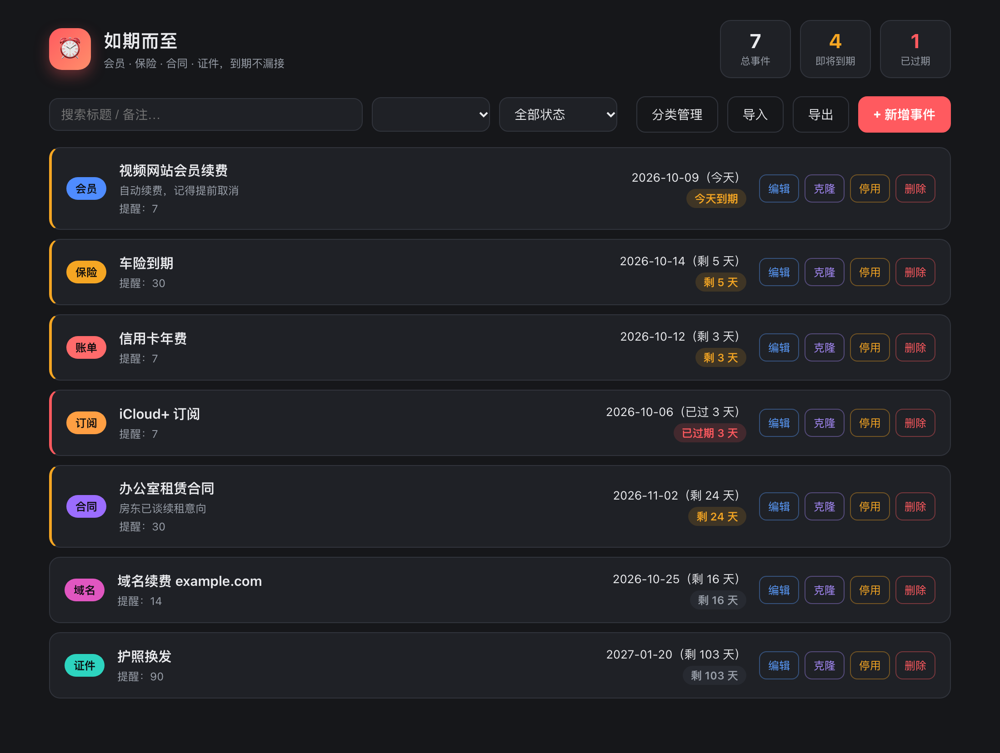
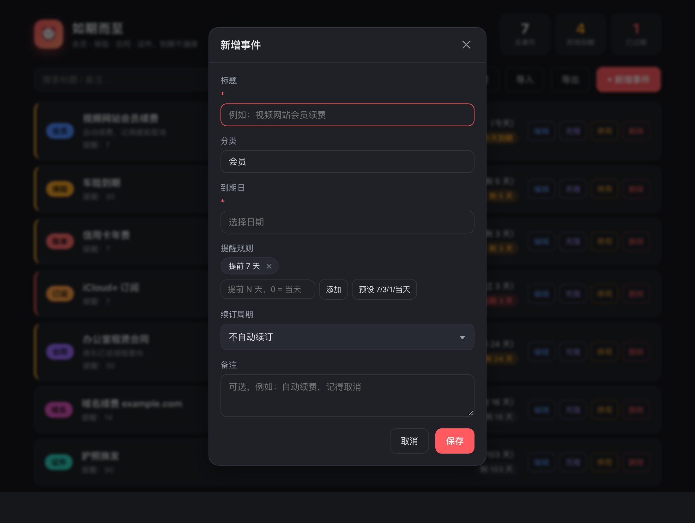
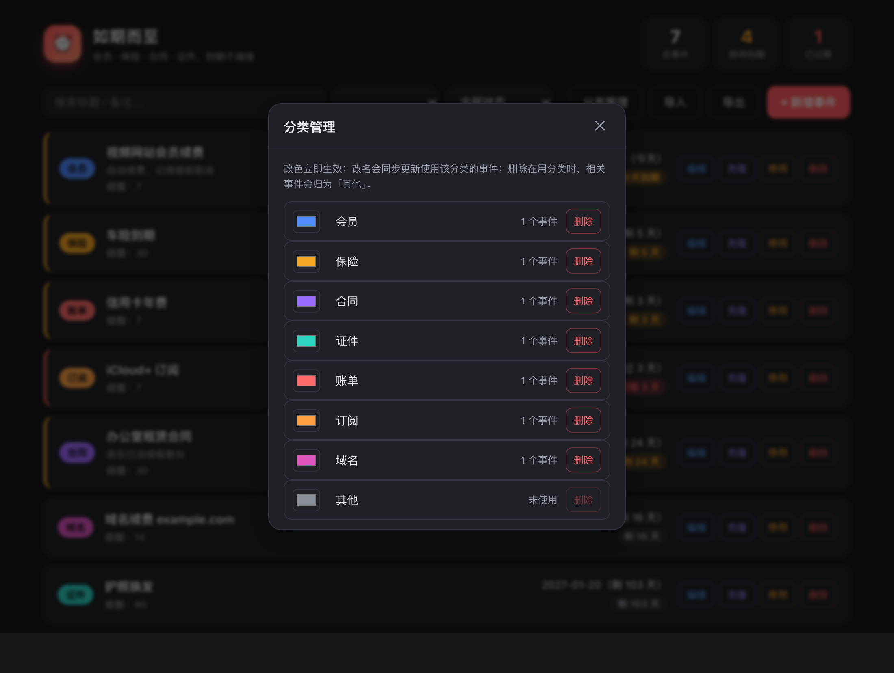

# 如期而至

<p align="center">
  
</p>

<p align="center">
  <a href="https://github.com/chaun1008/ruqi"></a>
  
  
  
</p>

**如期而至** 是一款跨平台桌面软件，帮你管理**会员、保险、合同、证件、账单、订阅**等一切会到期的事件，并在到期前按时弹出**系统级通知**——即使软件窗口关了，只要托盘里程序还在运行，就不会漏接。

> 名字取意「如约而至」：该提醒的，准时提醒你。

---

## ✨ 功能

- ➕ **自定义事件**：标题、分类、到期日、提前提醒天数、备注，想记什么记什么
- 🏷️ **预设 + 自定义分类**：会员 / 保险 / 合同 / 证件 / 账单 / 订阅 / 其他，也可自己输入
- 🔔 **系统级提醒**：后台每 60 秒扫描，进入「提前 N 天 ~ 过期 7 天」窗口的事件弹系统通知，每天最多一次
- 📌 **关窗不退出**：点关闭只是缩到系统托盘，进程仍在跑，从托盘菜单「显示主窗口 / 退出」
- 🔍 **筛选与搜索**：按分类筛选 + 关键字搜索，列表按到期日排序，临近 / 过期标红
- 💾 **本地数据 + 备份**：数据存本地 JSON，一键导出 / 导入，可随意拷贝到另一台电脑

---

## 📸 界面截图

**主界面**：事件按到期日排序，今天到期 / 临近 / 已过期一眼可辨，支持分类筛选与搜索。



**新增事件**：标题、分类、到期日、提醒规则、续订周期、备注，一次配齐。



**分类管理**：改色立即生效；改名自动同步事件；删除在用分类时事件归为「其他」。



---

## 📥 下载与安装

### 预编译包（推荐）

| 平台 | 文件 | 说明 |
| --- | --- | --- |
| macOS (Apple Silicon) | `如期而至.app.zip` | 解压后双击 `.app` 打开 |
| Windows | `如期而至_x.y.z_x64_en-US.msi` / `*.exe` | 双击安装 |

> 未签名时首次打开会被系统拦截：macOS 右键「打开」并确认；Windows 点「更多信息 → 仍要运行」。

### 本地构建

```bash
git clone https://github.com/chaun1008/ruqi.git
cd ruqi
npm install      # 安装 @tauri-apps/cli
npm run build    # 产出平台安装包
```

产物位置：

- macOS：`src-tauri/target/release/bundle/macos/如期而至.app` 与 `…/dmg/如期而至.dmg`
- Windows：`src-tauri/target/release/bundle/msi/如期而至_x.y.z_x64_en-US.msi` 与 `nsis/*.exe`

#### 前置依赖

- **macOS**：[Rust](https://www.rust-lang.org/) + Xcode 命令行工具（`xcode-select --install`）+ Node.js 18+
- **Windows**：[Rust](https://www.rust-lang.org/)（MSVC 工具链）+ [Node.js](https://nodejs.org/) 18+ + [WebView2](https://developer.microsoft.com/microsoft-edge/webview2/) 运行时
- **Linux**（额外支持）：`webkit2gtk-4.1` / `librsvg` / `patchelf` 等系统库

---

## 🚀 使用

1. 打开应用，点「+ 新增事件」填入标题、分类、到期日与提前提醒天数
2. 列表按到期日排序，临近 / 逾期会自动标红，并弹系统通知
3. 关闭窗口后程序驻留托盘，到点在系统通知里提醒你
4. 换电脑或备份：用「导出」存成 JSON，另一台机器「导入」即可恢复

---

## 🗂️ 数据在哪里

运行时数据保存在本地 `events.json`：

- macOS：`~/Library/Application Support/com.ruqierzhi.app/events.json`
- Windows：`C:\Users\<你>\AppData\Roaming\com.ruqierzhi.app\events.json`

备份 / 迁移：界面「导出」保存为 JSON，换机后「导入」恢复（导入会覆盖当前数据）。

---

## 🔧 提醒机制

- 启动时后台起一个线程，每 60 秒检查全部事件
- 命中「提前 N 天 ~ 过期 7 天」窗口、且**当天尚未通知过**的事件，立即弹系统通知（每天最多一次，避免刷屏）
- 窗口关闭只是隐藏到托盘，进程仍在运行，因此关窗也能按时收到提醒
- 彻底停止提醒：从托盘菜单「退出」

---

## 🧱 技术栈

- 前端：原生 HTML / CSS / JavaScript（通过 Tauri 全局 API `window.__TAURI__.core.invoke` 调用后端）
- 后端：Rust + Tauri 2 + `tauri-plugin-notification` + `tauri-plugin-dialog`
- 打包：`@tauri-apps/cli`（`tauri build`）
- 图标：纯 Python 脚本 `src-tauri/gen_icon.py` 生成源图，再经 `tauri icon` 出全套

---

## 📂 目录结构

```
ruqi/
├── package.json            # 前端脚本（tauri dev / build / icon）
├── src/                   # 前端（纯静态 HTML/CSS/JS，无打包依赖）
│   ├── index.html
│   ├── style.css
│   └── app.js
├── src-tauri/             # Rust 后端 + Tauri 配置
│   ├── Cargo.toml
│   ├── tauri.conf.json
│   ├── build.rs
│   ├── capabilities/default.json
│   ├── src/main.rs         # 持久化 / 调度线程 / 托盘 / 通知
│   ├── icons/             # 应用图标（tauri icon 生成）
│   ├── icon-source.png    # 图标源图
│   └── gen_icon.py        # 图标源图生成脚本
├── LICENSE
├── .gitignore
└── README.md
```

---

## 🗺️ 路线图

- [ ] 重复周期事件（每年自动续期提醒）
- [ ] 开机自启
- [ ] 农历 / 工作日提醒
- [ ] 多语言（中英切换）

欢迎提 Issue 与 PR。

---

## 🤝 贡献

1. Fork 本仓库并 `git clone` 到本地
2. 创建分支：`git checkout -b feat/your-feature`
3. 提交修改：`git commit -m "feat: ..."`
4. 推送并提 PR

提交前请确保 `cargo check` 与 `npm run build` 通过。

---

## 📄 开源协议

[MIT](LICENSE) © Ruqi Contributors
